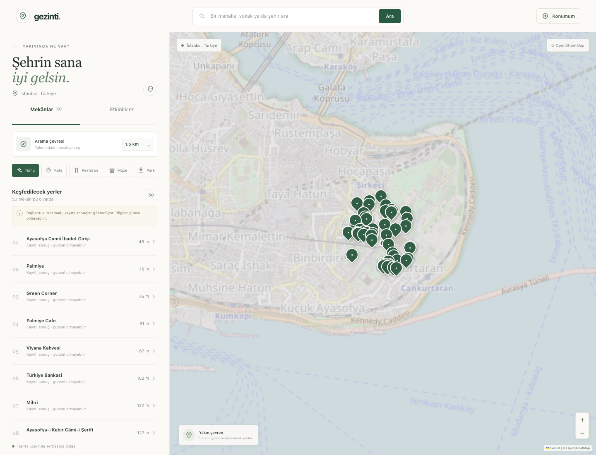
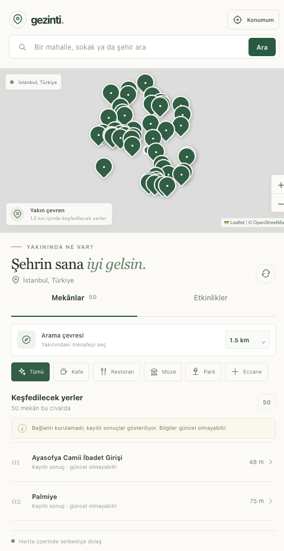
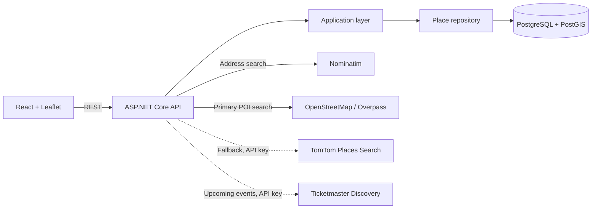

# Gezinti


**Explore a city one nearby place at a time.** Gezinti is a location-aware discovery app for finding places around an address, neighborhood, or map point. It combines a React map interface with an ASP.NET Core API, PostGIS search, and external place and event providers.

[Türkçe](README.tr.md) · [Desktop screenshot](docs/screenshots/gezinti-desktop.png) · [Mobile screenshot](docs/screenshots/gezinti-mobile.png)

<p align="center">
  
</p>

<p align="center">
  
</p>

## What it does

- Search by city, district, neighborhood, street, or address and move the map to the selected result.
- Browse nearby places on an interactive map, filter by category, and choose a search radius.
- Use the device's current location or move the map and search the visible area.
- Query OpenStreetMap data first, then try TomTom Places Search when the primary provider fails. Cached places can be used when external providers are unavailable.
- Browse upcoming music events from Ticketmaster, with venue, start time, distance, and ticket link.
- Store and query place data in PostgreSQL with PostGIS spatial functions.

## Stack

| Area | Technologies |
| --- | --- |
| Frontend | React, TypeScript, Vite, Leaflet |
| API | .NET 10, ASP.NET Core, Swagger / OpenAPI |
| Application architecture | Clean Architecture: API, Application, Infrastructure, Domain |
| Persistence | PostgreSQL, PostGIS, Entity Framework Core, NetTopologySuite |
| Place search | Nominatim, OpenStreetMap Overpass, optional TomTom Places Search |
| Events | Optional Ticketmaster Discovery API |
| Local services | Docker Compose |

## Architecture



## Run locally

### Requirements

- .NET 10 SDK
- Node.js 22 or later and npm
- Docker Desktop with Docker Compose
- `dotnet-ef` CLI for applying database migrations

### 1. Start PostGIS

From the repository root:

```sh
docker compose up -d
```

The development database listens on port `5433`. The Compose file uses the local demo credentials `postgres / gezinti_dev_password`; change them before using this setup anywhere outside local development.

### 2. Configure and start the API

In a terminal at the repository root, set the local database connection and apply migrations:

```sh
export ConnectionStrings__DefaultConnection='Host=localhost;Port=5433;Database=gezinti;Username=postgres;Password=gezinti_dev_password'
dotnet ef database update --project backend/Gezinti.Infrastructure --startup-project backend/Gezinti.API
dotnet run --project backend/Gezinti.API --launch-profile http
```

The API listens at `http://localhost:5056`. In Development, Swagger UI is available at `http://localhost:5056/swagger`.

If `dotnet ef` is not installed:

```sh
dotnet tool install --global dotnet-ef
```

### 3. Start the frontend

In a second terminal:

```sh
cd frontend
npm ci
npm run dev
```

Open `http://localhost:5173`. Allow location access in the browser when using the current-location button. The frontend uses `http://localhost:5056` by default. To point it at another API, create `frontend/.env.local` from [`frontend/.env.example`](frontend/.env.example) and set `VITE_API_BASE_URL`.

## Optional data providers

The app can run locally without these API keys. OpenStreetMap place search and address search remain available; the fallback place provider and live event listings require keys.

Keep keys in .NET User Secrets. Never commit them in `appsettings*.json`, `.env`, screenshots, or documentation.

```sh
dotnet user-secrets set "TomTom:ApiKey" "YOUR_TOMTOM_KEY" --project backend/Gezinti.API
dotnet user-secrets set "Ticketmaster:ApiKey" "YOUR_TICKETMASTER_KEY" --project backend/Gezinti.API
```

TomTom is tried after OpenStreetMap when configured. Place lookup has a ten-second overall provider budget, and cached results can be returned when remote services fail. The Events tab searches upcoming music events through Ticketmaster; it reports when the provider key is missing instead of showing sample data.

## API overview

| Endpoint | Purpose |
| --- | --- |
| `GET /api/locations/search?q=...` | Find a place name or address and return map coordinates |
| `GET /api/places/nearby?latitude=...&longitude=...&radius=...` | Find nearby places; accepts an optional `category` |
| `GET /api/events/nearby?latitude=...&longitude=...&radius=...` | Find upcoming nearby music events |

## Build

```sh
dotnet build backend/Gezinti.API/Gezinti.API.csproj
cd frontend && npm ci && npm run build
```

## Data and attribution

Map tiles and OpenStreetMap-derived place data are attributed to [OpenStreetMap contributors](https://www.openstreetmap.org/copyright). Address search uses Nominatim. Optional place and event results come from TomTom and Ticketmaster and are subject to their respective coverage, terms, and usage limits.

## Project status

Gezinti is a portfolio project under active development. The repository contains a local demo setup; no hosted public demo is configured yet. External provider coverage varies by location, and live Ticketmaster events require a developer API key.
