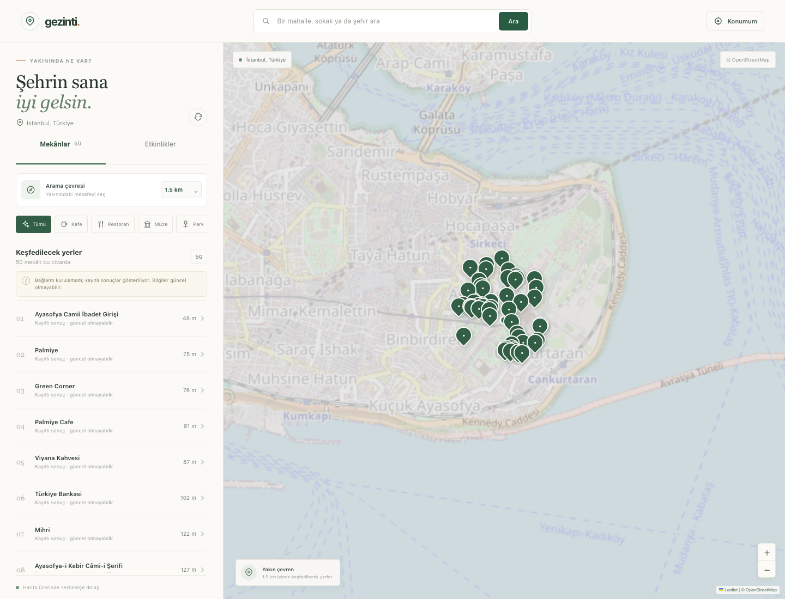
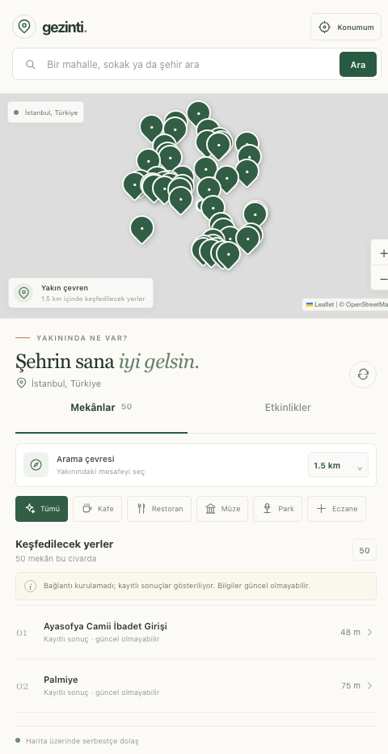
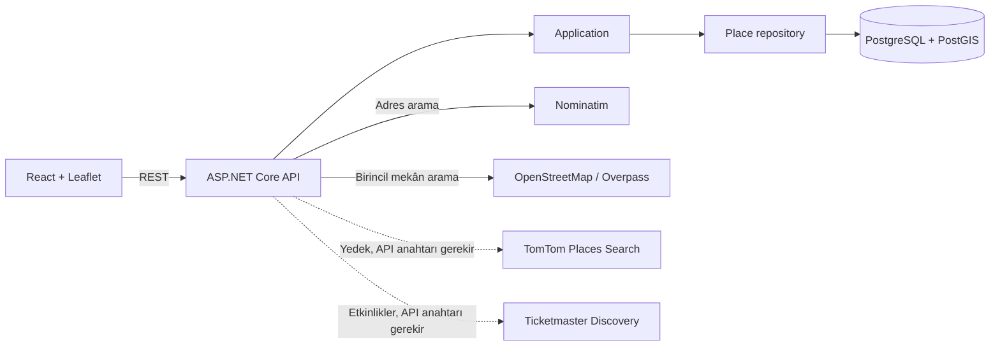

# Gezinti

**Şehrini, yakınındaki yerlerden başlayarak keşfet.** Gezinti; adres, mahalle veya harita konumu çevresinde mekân bulmaya yarayan konum tabanlı bir keşif uygulamasıdır. React harita arayüzünü ASP.NET Core API, PostGIS aramaları ve harici mekân/etkinlik servisleriyle bir araya getirir.

[English](README.md) · [Masaüstü ekran görüntüsü](docs/screenshots/gezinti-desktop.png) · [Mobil ekran görüntüsü](docs/screenshots/gezinti-mobile.png)

<p align="center">
  
</p>

<p align="center">
  
</p>

## Özellikler

- Şehir, ilçe, mahalle, sokak veya adres ara; seçilen konuma haritadan git.
- Yakındaki yerleri haritada görüntüle, kategoriye göre filtrele ve arama mesafesini seç.
- Cihazın mevcut konumunu kullan veya haritada alan değiştirip yeniden ara.
- Önce OpenStreetMap verisini sorgula; servis yanıt vermezse yapılandırılmış TomTom Places Search yedeğini dene. Dış servisler çalışmadığında önbellekteki mekânları göster.
- Ticketmaster’dan yaklaşan müzik etkinliklerini mekân, tarih, mesafe ve bilet bağlantısıyla listele.
- PostgreSQL ve PostGIS üzerinde mekân verilerini sakla ve konumsal sorgula.

## Teknolojiler

| Alan | Teknolojiler |
| --- | --- |
| Ön yüz | React, TypeScript, Vite, Leaflet |
| API | .NET 10, ASP.NET Core, Swagger / OpenAPI |
| Mimari | Clean Architecture: API, Application, Infrastructure, Domain |
| Veri katmanı | PostgreSQL, PostGIS, Entity Framework Core, NetTopologySuite |
| Dış servisler | Nominatim, OpenStreetMap Overpass, TomTom Places Search, Ticketmaster Discovery |
| Yerel servisler | Docker Compose |

## Mimari



## Yerelde çalıştırma

### Gereksinimler

- .NET 10 SDK
- Node.js 22 veya sonrası ve npm
- Docker Desktop ve Docker Compose
- Veritabanı migration’ları için `dotnet-ef` CLI (`dotnet tool install --global dotnet-ef`)

### 1. PostGIS’i başlat

Proje kökünde:

```sh
docker compose up -d
```

Geliştirme veritabanı `5433` portunda çalışır. Compose dosyasındaki `postgres / gezinti_dev_password` bilgileri yalnızca yerel demo içindir; bu kurulumu yerel geliştirme dışında kullanacaksan değiştir.

### 2. API’yi yapılandır ve başlat

Proje kökünde aynı terminalde:

```sh
export ConnectionStrings__DefaultConnection='Host=localhost;Port=5433;Database=gezinti;Username=postgres;Password=gezinti_dev_password'
dotnet ef database update --project backend/Gezinti.Infrastructure --startup-project backend/Gezinti.API
dotnet run --project backend/Gezinti.API --launch-profile http
```

API `http://localhost:5056` adresinde, Development Swagger arayüzü ise `http://localhost:5056/swagger` adresinde açılır.

### 3. Ön yüzü başlat

İkinci bir terminalde:

```sh
cd frontend
npm ci
npm run dev
```

`http://localhost:5173` adresini aç. Cihaz konumunu kullanmak için sayfadaki **Konumum** düğmesine basıp tarayıcı iznini ver. Ön yüz varsayılan olarak `http://localhost:5056` API’sine bağlanır. Başka bir API adresi için [`frontend/.env.example`](frontend/.env.example) dosyasını `frontend/.env.local` olarak kopyalayıp `VITE_API_BASE_URL` değerini değiştir.

## İsteğe bağlı veri servisleri

Uygulama bu anahtarlar olmadan yerelde açılır. OpenStreetMap mekân araması ve adres araması kullanılabilir; TomTom yedeği ve canlı etkinlik listesi için API anahtarı gerekir. Anahtarları .NET User Secrets’ta sakla; `appsettings*.json`, `.env`, ekran görüntüsü veya dokümantasyona ekleme.

```sh
dotnet user-secrets set "TomTom:ApiKey" "TOMTOM_API_ANAHTARIN" --project backend/Gezinti.API
dotnet user-secrets set "Ticketmaster:ApiKey" "TICKETMASTER_API_ANAHTARIN" --project backend/Gezinti.API
```

OpenStreetMap yanıt vermediğinde yapılandırılmışsa TomTom denenir. Mekân servislerinin toplam yanıt süresi 10 saniyeyle sınırlıdır; dış servisler çalışmadığında önbellekteki sonuçlar gösterilebilir. Ticketmaster anahtarı yoksa etkinlikler sekmesi örnek veri göstermek yerine ayar gerektiğini bildirir.

## API uç noktaları

| Uç nokta | Amaç |
| --- | --- |
| `GET /api/locations/search?q=...` | Konum/adres bulur ve harita koordinatlarını döndürür |
| `GET /api/places/nearby?latitude=...&longitude=...&radius=...` | Yakındaki mekânları bulur; isteğe bağlı `category` parametresi alır |
| `GET /api/events/nearby?latitude=...&longitude=...&radius=...` | Yaklaşan müzik etkinliklerini getirir |

## Derleme

```sh
dotnet build backend/Gezinti.API/Gezinti.API.csproj
cd frontend && npm ci && npm run build
```

## Veri kaynakları ve proje durumu

Harita döşemeleri ve OpenStreetMap kaynaklı mekân verileri [OpenStreetMap katkıcılarına](https://www.openstreetmap.org/copyright) atfedilir. Adres araması Nominatim kullanır. İsteğe bağlı mekân ve etkinlik sonuçları TomTom ve Ticketmaster’dan gelir; kapsama ve limitler bu servislerin koşullarına bağlıdır.

Gezinti geliştirilmekte olan bir portfolyo projesidir. Repoda yerel demo kurulumu bulunur; herkese açık barındırılan bir demo henüz yoktur. Etkinlik verisi için Ticketmaster geliştirici anahtarı gerekir.
